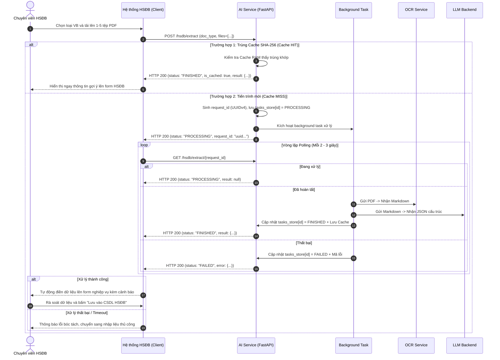

# TÀI LIỆU ĐẶC TẢ GIAO DIỆN LẬP TRÌNH ỨNG DỤNG (API SPECIFICATION)
## HỆ THỐNG AI TRÍCH XUẤT VĂN BẢN HỒ SƠ ĐẠI BIỂU (DEPUTY PROFILING AI SERVICE)

- **Mã hệ thống**: `DeputyProfiling-InformationRetrieval`
- **Phiên bản API (API Version)**: `4.2.0`
- **Tiêu chuẩn thiết kế**: RESTful API, OpenAPI 3.0 (FastAPI / Pydantic V2)
- **Cơ chế truyền thông**: Bất đồng bộ qua Polling (`request_id` - UUIDv4) kết hợp Caching băm nội dung SHA-256
- **Đối tượng sử dụng**: Đội ngũ phát triển hệ thống HSĐB, Kiến trúc sư hệ thống, Đội ngũ Đánh giá An toàn Thông tin (ATTT)
- **Phạm vi lưu trữ**: Dịch vụ hoạt động dạng xử lý bộ nhớ tạm (In-Memory Processing), **chưa tích hợp cơ sở dữ liệu (No Database)**

---

## MỤC LỤC
1. [Tổng quan & Nguyên tắc Thiết kế API](#1-tổng-quan--nguyên-tắc-thiết-kế-api)
2. [Cơ chế Nhận Dữ liệu (File PDF) & Gửi trả Phản hồi (Response)](#2-cơ-chế-nhận-dữ-liệu-file-pdf--gửi-trả-phản-hồi-response)
3. [Phương án Tích hợp Hệ thống: Cơ chế Polling Định kỳ & Bộ nhớ đệm](#3-phương-án-tích-hợp-hệ-thống-cơ-chế-polling-định-kỳ--bộ-nhớ-đệm)
4. [Quy chuẩn Dữ liệu & Kiểm soát Biên Đầu vào (Input Validation)](#4-quy-chuẩn-dữ-liệu--kiểm-soát-biên-đầu-vào-input-validation)
5. [Đặc tả Chi tiết các Điểm cuối API (API Endpoints Specification)](#5-đặc-tả-chi-tiết-các-điểm-cuối-api-api-endpoints-specification)
   - 5.1. [Kiểm tra Tình trạng Hoạt động: `GET /health`](#51-kiểm-tra-tình-trạng-hoạt-động-get-health)
   - 5.2. [Khởi tạo Tiến trình Trích xuất: `POST /hsdb/extract`](#52-khởi-tạo-tiến-trình-trích-xuất-post-hsdbextract)
   - 5.3. [Truy vấn Trạng thái & Kết quả Bóc tách: `GET /hsdb/extract/{request_id}`](#53-truy-vấn-trạng-thái--kết-quả-bóc-tách-get-hsdbextractrequest_id)
6. [Hệ thống Mã lỗi & Mã Cảnh báo Nghiệp vụ (Error & Warning Matrix)](#6-hệ-thống-mã-lỗi--mã-cảnh-báo-nghiệp-vụ-error--warning-matrix)

---

## 1. TỔNG QUAN & NGUYÊN TẮC THIẾT KẾ API

### 1.1. Mục đích Nghiệp vụ
**DeputyProfiling AI Service** là một thành phần microservice chuyên biệt phục vụ Hệ thống Quản lý Hồ sơ Đại biểu (HSĐB) của Quốc hội:
1. Tiếp nhận các văn bản quyết định, nghị quyết nhân sự dạng tệp PDF (bao gồm các bản scan tài liệu có mộc đỏ, chữ ký và chữ viết tay).
2. Tương tác với dịch vụ OCR nội bộ để nhận diện văn bản và phục dựng cấu trúc bảng biểu, phụ lục danh sách.
3. Sử dụng mô hình ngôn ngữ lớn (LLM) để bóc tách thông tin có cấu trúc chuẩn mực (JSON).
4. Cung cấp dữ liệu để hệ thống HSĐB **tự động điền (auto-fill)** vào các form thêm mới thông tin, giảm thiểu thao tác nhập liệu thủ công.

### 1.2. Nguyên tắc Thiết kế
- **Ranh giới trách nhiệm (Trust Boundary)**: AI Service đóng vai trò là dịch vụ trích xuất độc lập. Kết quả bóc tách mang tính chất **gợi ý (suggestion)**; chuyên viên phụ trách nghiệp vụ của hệ thống HSĐB sẽ rà soát và xác nhận trước khi lưu trữ vào CSDL của HSĐB.
- **Không tự suy đoán (Zero Hallucination Assumption)**: Nếu văn bản gốc thiếu thông tin hoặc scan quá mờ không thể nhận dạng, API trả giá trị `null`. Hệ thống tuyệt đối không tự bịa đặt hay suy diễn dữ liệu ngoài văn bản.
- **Tiêu chuẩn dữ liệu chung**:
  - Chuẩn mã hóa: JSON UTF-8 (Unicode NFC).
  - Ngày tháng: Định dạng chuẩn `DD/MM/YYYY` (ví dụ: `26/12/2024`, `06/08/2018`).
  - Số thập phân: Sử dụng dấu chấm `.` (ví dụ: `6.92`, `7.28`, `0.8`).
  - Tiền tệ: Số nguyên VNĐ (ví dụ: `1872000`).

---

## 2. CƠ CHẾ NHẬN DỮ LIỆU (FILE PDF) & GỬI TRẢ PHẢN HỒI (RESPONSE)

Hệ thống được thiết kế theo nguyên lý xử lý dữ liệu trung thực, an toàn trên bộ nhớ RAM và **hoàn toàn chưa kết nối với cơ sở dữ liệu (Database)**.

```
[Client / Hệ thống HSĐB]
       │
       │ 1. POST /hsdb/extract (multipart/form-data: doc_type, files=[...])
       ▼
┌────────────────────────────────────────────────────────────────────────┐
│ FastAPI Application (app.py)                                          │
│                                                                        │
│   a) Tiếp nhận & Kiểm tra:                                             │
│      - Đọc files trực tiếp vào RAM (in-memory bytes)                   │
│      - Kiểm tra whitelist: MIME application/pdf, extension .pdf, <=30MB│
│      - Nếu tải lên 2-5 files: Ghép nối (concatenate) in-memory bằng    │
│        pypdf (io.BytesIO) thành 1 khối bytes duy nhất                  │
│                                                                        │
│   b) Kiểm tra Bộ nhớ đệm (CacheManager - in-memory Dict):              │
│      - Key = SHA256(doc_type + file_bytes)                            │
│      - Nếu Cache HIT: Trả ngay FINISHED kèm result (status 200)        │
│                                                                        │
│   c) Nếu Cache MISS:                                                   │
│      - Cấp phát request_id = str(uuid.uuid4())                         │
│      - Ghi nhận trạng thái vào RAM: tasks_store[request_id] =          │
│        {"status": "PROCESSING", "result": None, ...}                   │
│      - Đẩy tác vụ vào BackgroundTasks                                  │
│                                                                        │
│ 2. Trả ngay phản hồi khởi tạo: {"request_id": "...", "status": "PROCESSING"} │
└────────────────────────────────────────────────────────────────────────┘
       │
       │ (Tiến trình nền xử lý hoàn toàn trên RAM)
       ├─────────────────────────────────────────┐
       ▼                                         ▼
┌────────────────────────┐              ┌────────────────────────┐
│ Dịch vụ OCR Nội bộ     │              │ Dịch vụ LLM Backend    │
│ Gửi bytes qua HTTP     │              │ Nhận Markdown, bóc tách│
│ Nhận lại Markdown/Tree │              │ JSON có cấu trúc       │
└────────────────────────┘              └────────────────────────┘
       │                                         │
       └────────────────────┬────────────────────┘
                            ▼
┌────────────────────────────────────────────────────────────────────────┐
│ Cập nhật Trạng thái trên RAM:                                          │
│ - tasks_store[request_id] = {"status": "FINISHED", "result": result}   │
│ - Lưu đệm: cache_manager.set(cache_key, result) (TTL 24h trên RAM)     │
└────────────────────────────────────────────────────────────────────────┘
```

### 2.1. Cơ chế Tiếp nhận Dữ liệu (Input Data Reception)
- **Giao thức & Định dạng truyền tải**: Giao thức HTTP/HTTPS với `Content-Type: multipart/form-data`.
- **Tiếp nhận hoàn toàn trên bộ nhớ RAM (In-Memory Streaming)**:
  - Tệp PDF được FastAPI tiếp nhận qua đối tượng `UploadFile` và đọc trực tiếp vào bộ nhớ dưới dạng mảng byte thuần túy (`await upload_file.read()`).
  - **Không ghi tệp xuống ổ đĩa cứng vật lý**: Trong suốt quy trình bóc tách tiêu chuẩn, ứng dụng không lưu tệp tạm ra disk, ngăn chặn các nguy cơ rò rỉ dữ liệu hoặc mã độc từ tệp tải lên.
- **Ghép nối tệp đa phần tự động ([`concatenate_pdf_files`](app.py))**:
  - Khi một yêu cầu chứa từ 2 đến 5 tệp PDF (ví dụ: Quyết định chính kèm theo các tệp phụ lục danh sách rời), hệ thống sử dụng module `pypdf.PdfWriter` đọc qua luồng bộ nhớ ảo `io.BytesIO` để ghép các trang tài liệu lại thành 1 tệp PDF duy nhất trên RAM trước khi chuyển tiếp sang dịch vụ OCR.
- **Chuyển tiếp đến OCR Service**:
  - Khối dữ liệu nhị phân sau khi ghép được chuyển tiếp nguyên vẹn qua HTTP POST (dưới dạng form payload `files={"file": (filename, bytes, "application/pdf")}`) sang dịch vụ OCR nội bộ ([`services/ocr_service.py`](services/ocr_service.py)).

### 2.2. Cơ chế Gửi trả Phản hồi (Response Dispatching)
- **Không sử dụng Database**:
  - Toàn bộ kết quả xử lý và trạng thái tiến trình được quản lý trong bộ nhớ RAM thông qua cấu trúc dữ liệu từ điển Python:
    - Biến `tasks_store: Dict[str, dict]` (quản lý trạng thái tác vụ theo `request_id`).
    - Biến `cache_manager._cache_store: Dict[str, Tuple[float, ExtractionResult]]` (quản lý bộ nhớ đệm kết quả theo mã băm SHA-256).
- **Phản hồi tức thì (Immediate Response)**:
  - Khi nhận file, API không giữ kết nối HTTP để chờ OCR và LLM chạy xong. Sau khi hoàn tất kiểm tra tính hợp lệ và tạo tác vụ nền, API lập tức phản hồi mã trạng thái HTTP 200 kèm `request_id` và trạng thái `"PROCESSING"` (thời gian phản hồi $< 100\text{ms}$).
- **Cập nhật và Trả kết quả**:
  - Khi tác vụ nền hoàn thành, kết quả bóc tách được chuyển đổi thành cấu trúc đối tượng JSON theo schema [`core/schemas.py`](core/schemas.py) và ghi đè vào `tasks_store[request_id]`.
  - Khi client gửi yêu cầu truy vấn đến điểm cuối `GET /hsdb/extract/{request_id}`, hệ thống đọc trực tiếp từ `tasks_store` trong RAM và trả về dữ liệu kết quả JSON hoàn chỉnh.
- **Đặc tính lưu ý khi khởi động lại ứng dụng**:
  - Do chưa sử dụng cơ sở dữ liệu bền vững (Persistent Database / Redis), nếu tiến trình ứng dụng hoặc container bị khởi động lại (restart), toàn bộ dữ liệu trong `tasks_store` và `cache_store` sẽ được làm mới. Khi đó các yêu cầu polling với `request_id` cũ sẽ nhận mã lỗi `404 Not Found`.

---

## 3. PHƯƠNG ÁN TÍCH HỢP HỆ THỐNG: CƠ CHẾ POLLING ĐỊNH KỲ & BỘ NHỚ ĐỆM

Do đặc thù xử lý tài liệu hành chính quét mờ nhiều trang cần từ 15 đến 120 giây, phương án tích hợp chính thức giữa Hệ thống Hồ sơ Đại biểu (HSĐB) và AI Service là **Cơ chế Polling Định kỳ (Periodic Polling Pattern)**.

### 3.1. Sơ đồ Tuần tự Chi tiết (Detailed Sequence Diagram)



### 3.2. Quy tắc Vận hành Cơ chế Polling
1. **Chu kỳ Polling (Poll Interval)**:
   - Hệ thống Client gửi yêu cầu kiểm tra trạng thái mỗi **2 đến 3 giây một lần**.
   - Tuyệt đối không gửi polling liên tục dưới 1 giây để tránh lãng phí băng thông mạng nội bộ và tài nguyên CPU của server.
2. **Thời gian chờ tối đa (Client-side Timeout)**:
   - Đối với văn bản đơn lẻ (1 cá nhân như `QTCT`, `LUONG`, `PHU_CAP`): Khuyến nghị cấu hình timeout từ **60 đến 90 giây**.
   - Đối với văn bản danh sách nhiều trang (`KHEN_THUONG`, `KY_NIEM_CHUONG`, `QUY_HOACH`): Khuyến nghị cấu hình timeout từ **180 đến 300 giây**.
   - Nếu vượt quá ngưỡng timeout mà trạng thái vẫn là `PROCESSING`, client chủ động ngắt polling và hiển thị thông báo chuyển sang chế độ nhập liệu thủ công.
3. **Cơ chế Bộ nhớ đệm theo Mã băm (SHA-256 In-Memory Cache)**:
   - Mỗi bộ file tải lên được băm chuỗi kiểm tra:
     $$\text{Cache Key} = \text{SHA256}(\text{doc\_type} + \text{nội dung binary tất cả các file})$$
   - Khi chuyên viên vô tình gửi lại cùng một bộ tài liệu trong vòng **24 giờ** (`CACHE_TTL_SECONDS = 86400`), hệ thống trả ngay kết quả `FINISHED` từ RAM mà không kích hoạt xử lý OCR/LLM tốn kém tài nguyên.
   - Nếu muốn cưỡng bức bóc tách lại từ đầu, client truyền thêm cờ `force_reprocess=true` trong form data.
4. **Xử lý sự cố mất trạng thái (Fault Tolerance)**:
   - Nếu API trả mã lỗi `404 Not Found` trong quá trình polling (do service vừa khởi động lại làm mất `tasks_store` trong RAM), client cần nhận biết và hiển thị nút **"Thử lại" (Retry)** để gửi lại tệp lên server.

### 3.3. Mã giả Tích hợp Phía Client (Integration Pseudocode)

```javascript
/**
 * Ví dụ hàm tích hợp bóc tách tài liệu từ phía Client (JavaScript / TypeScript)
 */
async function extractDocumentAndAutoFill(docType, fileList) {
    const formData = new FormData();
    formData.append("doc_type", docType);
    for (const file of fileList) {
        formData.append("files", file);
    }
    formData.append("force_reprocess", "false");

    // Bước 1: Gửi yêu cầu khởi tạo bóc tách
    const initResponse = await fetch("http://<ai-service-host>:8000/hsdb/extract", {
        method: "POST",
        body: formData
    });
    
    if (!initResponse.ok) {
        throw new Error(`Lỗi khởi tạo: ${initResponse.statusText}`);
    }
    
    const initData = await initResponse.json();

    // Nếu trùng Cache, sử dụng kết quả ngay lập tức
    if (initData.status === "FINISHED" && initData.result) {
        applyResultToForm(initData.result);
        return;
    }

    const requestId = initData.request_id;
    const pollIntervalMs = 2500;
    const maxTimeoutMs = 180000; // 3 phút
    const startTime = Date.now();

    // Bước 2: Vòng lặp Polling kiểm tra trạng thái
    while (true) {
        await new Promise(resolve => setTimeout(resolve, pollIntervalMs));

        if (Date.now() - startTime > maxTimeoutMs) {
            throw new Error("Quá thời gian chờ xử lý tài liệu (Timeout). Vui lòng nhập thủ công.");
        }

        const pollResponse = await fetch(`http://<ai-service-host>:8000/hsdb/extract/${requestId}`);
        
        if (pollResponse.status === 404) {
            throw new Error("Phiên xử lý không tồn tại hoặc dịch vụ vừa khởi động lại. Vui lòng tải lại file.");
        }

        const pollData = await pollResponse.json();

        if (pollData.status === "FINISHED") {
            // Bước 3: Hoàn thành - Điền kết quả vào form nghiệp vụ
            applyResultToForm(pollData.result);
            break;
        } else if (pollData.status === "FAILED") {
            // Bước 4: Thất bại - Báo lỗi nghiệp vụ
            throw new Error(`Bóc tách thất bại: ${pollData.error?.message || "Lỗi không xác định"}`);
        }
        // Tiếp tục vòng lặp nếu trạng thái vẫn là "PROCESSING"
    }
}
```

---

## 4. QUY CHUẨN DỮ LIỆU & KIỂM SOÁT BIÊN ĐẦU VÀO (INPUT VALIDATION)

Toàn bộ dữ liệu đầu vào gửi tới API được kiểm soát thông qua hàm kiểm tra nghiêm ngặt tại [`app.py`](app.py):

### 4.1. Ràng buộc Tệp tin Đầu vào
1. **Số lượng tệp tin (`files`)**:
   - Tối thiểu: `1 file`.
   - Tối đa: `5 files`. Vượt quá ngưỡng này hệ thống trả mã lỗi `400 Bad Request`.
2. **Dung lượng tệp tin**:
   - Tối đa cho mỗi tệp: `30 MB` ($30 \times 1024 \times 1024$ bytes).
   - Vượt ngưỡng dung lượng: Hệ thống lập tức từ chối và trả mã lỗi `413 Request Entity Too Large`.
3. **Định dạng tệp tin (File Type Filtering)**:
   - MIME Type hợp lệ: Bắt buộc là `application/pdf`.
   - Phần mở rộng tệp (File Extension): Bắt buộc kết thúc bằng `.pdf` (không phân biệt hoa thường).
   - Sai định dạng: Trả mã lỗi `415 Unsupported Media Type`.
4. **Chuẩn hóa Tên tệp**:
   - Tên tệp được chuẩn hóa theo chuẩn Unicode NFC (`unicodedata.normalize('NFC', filename)`) để ngăn ngừa lỗi ký tự tiếng Việt có dấu dạng tổ hợp khi truyền qua header HTTP.

### 4.2. Ràng buộc Tham số Loại Văn bản (`doc_type`)
Tham số `doc_type` bắt buộc phải là một trong 7 giá trị Enum chuẩn mực được định nghĩa tại [`core/config.py`](core/config.py):

| Mã `doc_type` | Tên nghiệp vụ tương ứng | Đối tượng áp dụng | Cấu trúc bóc tách chính |
| :--- | :--- | :---: | :--- |
| **`QTCT`** | Quá trình công tác | 1 cá nhân | Bổ nhiệm, điều động, chức vụ cũ/mới, đơn vị cũ/mới, thời hạn bổ nhiệm. |
| **`LUONG`** | Nâng bậc lương | 1 cá nhân | Ngạch/mã ngạch, bậc lương cũ/mới, hệ số cũ/mới, mốc hưởng lương mới. |
| **`PHU_CAP`** | Quyết định phụ cấp | 1 cá nhân | Loại phụ cấp, hệ số hoặc số tiền, mốc thời gian áp dụng. |
| **`THI_DUA`** | Danh hiệu thi đua | N đối tượng | Danh hiệu công nhận, năm đạt, cấp khen thưởng, danh sách đối tượng. |
| **`KHEN_THUONG`** | Khen thưởng | N đối tượng | Hình thức khen thưởng, danh sách cá nhân/tập thể, phân nhóm theo đợt. |
| **`KY_NIEM_CHUONG`**| Kỷ niệm chương | N cá nhân | Tặng Kỷ niệm chương "Vì sự nghiệp Quốc hội VN", khóa ĐBQH, đoàn ĐBQH. |
| **`QUY_HOACH`** | Quy hoạch chức danh | N cá nhân | Phê duyệt chức danh cán bộ dự nguồn, nhiệm kỳ quy hoạch, chức vụ hiện tại. |

---

## 5. ĐẶC TẢ CHI TIẾT CÁC ĐIỂM CUỐI API (API ENDPOINTS SPECIFICATION)

---

### 5.1. Kiểm tra Tình trạng Hoạt động: `GET /health`

#### Mô tả nghiệp vụ
Điểm cuối cung cấp trạng thái khả dụng của dịch vụ phục vụ Docker healthcheck hoặc hệ sinh thái giám sát container.

#### Thông tin kỹ thuật
- **Phương thức HTTP**: `GET`
- **Đường dẫn**: `/health`
- **Tham số**: Không có

#### Phản hồi thành công (HTTP 200 OK)
```json
{
  "status": "ok",
  "version": "4.2.0"
}
```

---

### 5.2. Khởi tạo Tiến trình Trích xuất: `POST /hsdb/extract`

#### Mô tả nghiệp vụ
Tiếp nhận tài liệu PDF, kiểm tra bộ nhớ đệm hoặc kích hoạt tiến trình bóc tách ngầm qua background worker.

#### Thông tin kỹ thuật
- **Phương thức HTTP**: `POST`
- **Đường dẫn**: `/hsdb/extract`
- **Content-Type**: `multipart/form-data`

#### Tham số Yêu cầu (Form Data)
| Tên tham số | Kiểu dữ liệu | Bắt buộc | Mặc định | Mô tả |
| :--- | :--- | :---: | :---: | :--- |
| `doc_type` | `string` | **Có** | - | Một trong 7 mã: `QTCT`, `LUONG`, `PHU_CAP`, `THI_DUA`, `KHEN_THUONG`, `KY_NIEM_CHUONG`, `QUY_HOACH`. |
| `files` | `file[]` (PDF) | **Có** | - | Danh sách từ 1 đến 5 tệp PDF (tối đa 30MB/file). |
| `force_reprocess` | `boolean` | Không | `false` | Nếu `true`, bỏ qua bộ nhớ đệm và ép xử lý lại từ đầu. |

#### Ví dụ Lệnh cURL
```bash
curl -X POST "http://localhost:8000/hsdb/extract" \
  -F "doc_type=QTCT" \
  -F "files=@quyet_dinh_dieu_dong.pdf;type=application/pdf" \
  -F "force_reprocess=false"
```

#### Cấu trúc Phản hồi (HTTP 200 OK)

**Trường hợp 1: Khởi tạo tiến trình mới (Cache MISS)**
```json
{
  "request_id": "8f7e2c94-1a3b-4c5d-9e6f-7a8b9c0d1e2f",
  "status": "PROCESSING",
  "created_at": "2026-10-14T08:30:00.123456+00:00",
  "is_cached": null,
  "result": null
}
```

**Trường hợp 2: Trả kết quả ngay từ bộ nhớ đệm (Cache HIT)**
```json
{
  "request_id": "8f7e2c94-1a3b-4c5d-9e6f-7a8b9c0d1e2f",
  "status": "FINISHED",
  "created_at": null,
  "is_cached": true,
  "result": {
    "status": "success",
    "error": null,
    "doc_type": "QTCT",
    "person_count_declared": 1,
    "tong_so_ca_nhan": 1,
    "metadata": {
      "document_number": "1122/QĐ-VPQH",
      "document_name": "Về việc điều động và bổ nhiệm công chức",
      "issue_date": "06/08/2018",
      "issue_unit": "Văn phòng Quốc hội",
      "signer": "Nguyễn Hạnh Phúc",
      "content": "Điều 1. Điều động và bổ nhiệm ông Nguyễn Hải Long...",
      "doc_type_detected": "QTCT"
    },
    "detail": {
      "process_type": "Điều động và bổ nhiệm",
      "start_date": "10/08/2018",
      "from_organization_name": "Vụ Công tác đại biểu, Văn phòng Quốc hội",
      "work_organization_name": "Trung tâm Bồi dưỡng đại biểu dân cử",
      "position_name": "Phó Giám đốc",
      "position_detail": "Phó Giám đốc Trung tâm Bồi dưỡng đại biểu dân cử",
      "appointment_term_years": 5.0,
      "allowance_name": "Phụ cấp chức vụ lãnh đạo",
      "allowance_factor": 0.8
    },
    "groups": [],
    "persons": [
      {
        "stt": 1,
        "group_index": null,
        "code": null,
        "is_collective": false,
        "full_name": "Nguyễn Hải Long",
        "position_name": "Phó Vụ trưởng",
        "work_organization_name": "Vụ Công tác đại biểu, Văn phòng Quốc hội",
        "raw_text": "Điều 1. Điều động và bổ nhiệm ông Nguyễn Hải Long, Phó Vụ trưởng Vụ Công tác đại biểu..."
      }
    ],
    "warnings": []
  }
}
```

---

### 5.3. Truy vấn Trạng thái & Kết quả Bóc tách: `GET /hsdb/extract/{request_id}`

#### Mô tả nghiệp vụ
Phía client thực hiện polling định kỳ để lấy trạng thái tiến trình và nhận kết quả trích xuất cấu trúc hoàn chỉnh.

#### Thông tin kỹ thuật
- **Phương thức HTTP**: `GET`
- **Đường dẫn**: `/hsdb/extract/{request_id}`
- **Tham số Path**: `request_id` (chuỗi UUIDv4 nhận được từ bước khởi tạo)

#### Ví dụ Lệnh cURL
```bash
curl -X GET "http://localhost:8000/hsdb/extract/8f7e2c94-1a3b-4c5d-9e6f-7a8b9c0d1e2f"
```

#### Cấu trúc Phản hồi theo Trạng thái (HTTP 200 OK)

**1. Đang xử lý (`status = "PROCESSING"`)**
```json
{
  "request_id": "8f7e2c94-1a3b-4c5d-9e6f-7a8b9c0d1e2f",
  "status": "PROCESSING",
  "result": null,
  "error": null
}
```

**2. Hoàn tất thành công (`status = "FINISHED"`)**
```json
{
  "request_id": "8f7e2c94-1a3b-4c5d-9e6f-7a8b9c0d1e2f",
  "status": "FINISHED",
  "result": {
    "status": "success",
    "error": null,
    "doc_type": "LUONG",
    "person_count_declared": 1,
    "tong_so_ca_nhan": 1,
    "metadata": {
      "document_number": "3110-QĐ/HVCTQG",
      "document_name": "Về việc nâng bậc lương đối với cán bộ, công chức, viên chức",
      "issue_date": "15/06/2024",
      "issue_unit": "Học viện Chính trị quốc gia Hồ Chí Minh",
      "signer": "Đoàn Minh Huấn",
      "content": "Điều 1. Nâng bậc lương thường xuyên đối với ông Vũ Văn A...",
      "doc_type_detected": "LUONG"
    },
    "detail": {
      "raise_salary_reason": "Nâng bậc lương thường xuyên",
      "position_wage": "Giảng viên cao cấp (hạng I)",
      "position_wage_code": "V.07.01.01",
      "old_step": 3,
      "old_factor": 6.92,
      "salary_step": 4,
      "salary_factor": 7.28,
      "start_date": "01/06/2024",
      "review_date": "01/06/2027",
      "percentage": null
    },
    "groups": [],
    "persons": [
      {
        "stt": 1,
        "group_index": null,
        "code": null,
        "is_collective": false,
        "full_name": "Vũ Văn A",
        "position_name": "Giảng viên cao cấp",
        "work_organization_name": "Học viện Chính trị quốc gia Hồ Chí Minh",
        "raw_text": "Điều 1. Nâng bậc lương thường xuyên đối với ông Vũ Văn A, Giảng viên cao cấp..."
      }
    ],
    "warnings": []
  },
  "error": null
}
```

**3. Thất bại nghiệp vụ (`status = "FAILED"`)**
```json
{
  "request_id": "8f7e2c94-1a3b-4c5d-9e6f-7a8b9c0d1e2f",
  "status": "FAILED",
  "result": null,
  "error": {
    "code": "UNREADABLE_CONTENT",
    "message": "File 'scan_mo.pdf' không chứa nội dung văn bản nào sau khi OCR (bản scan quá mờ hoặc rỗng)."
  }
}
```


## 6. HỆ THỐNG MÃ LỖI & MÃ CẢNH BÁO NGHIỆP VỤ (ERROR & WARNING MATRIX)

Hệ thống phân định rõ ràng giữa **Mã trạng thái HTTP (Transport Level)**, **Mã lỗi nghiệp vụ (Application Level)** và **Mã cảnh báo nghiệp vụ (Business Warnings)** để đảm bảo an toàn thông tin, không để lộ cấu trúc kỹ thuật nội bộ ra ngoài client.

### 6.1. Mã Trạng thái HTTP (HTTP Status Codes)
| Mã HTTP | Tên mã chuẩn | Nguyên nhân phát sinh |
| :---: | :--- | :--- |
| **`200`** | OK | Xử lý yêu cầu thành công, kiểm tra trường `status` trong body để biết tiến độ. |
| **`400`** | Bad Request | Tham số không hợp lệ (sai mã `doc_type`, thiếu tệp đính kèm hoặc tải lên vượt quá 5 tệp). |
| **`404`** | Not Found | Không tìm thấy `request_id` (chưa từng tồn tại hoặc đã quá hạn lưu trữ trên RAM / service vừa khởi động lại). |
| **`413`** | Payload Too Large | Tệp tải lên có dung lượng vượt quá giới hạn cho phép ($> 30\text{MB}$). |
| **`415`** | Unsupported Media Type | Tệp tải lên không phải là định dạng PDF hợp lệ (sai MIME Type hoặc phần mở rộng). |
| **`422`** | Unprocessable Entity | Tài liệu scan trắng hoàn toàn, quá mờ không thể nhận diện được ký tự văn bản (`UNREADABLE_CONTENT`). |
| **`502`** | Bad Gateway | Không thể kết nối hoặc nhận phản hồi lỗi từ dịch vụ OCR / LLM backend nội bộ. |
| **`504`** | Gateway Timeout | Dịch vụ OCR hoặc LLM backend phản hồi vượt quá thời gian timeout quy định. |

### 6.2. Mã Lỗi Nghiệp vụ (`result.error.code`)
Khi tiến trình xử lý gặp lỗi và trả về `status = "FAILED"`, đối tượng `error` sẽ chứa mã chuẩn hóa thay vì ném stack trace hệ thống:
- `UNREADABLE_CONTENT`: Bản scan quá mờ, trang trắng hoặc rỗng, không thể nhận dạng ký tự.
- `UNSUPPORTED_DOCUMENT`: Nội dung văn bản không thuộc phạm vi 7 loại quyết định được hỗ trợ.
- `OCR_CONNECTION_ERROR`: Không thể kết nối đến máy chủ dịch vụ OCR nội bộ.
- `OCR_TIMEOUT_ERROR`: Dịch vụ OCR xử lý quá thời gian quy định.
- `LLM_PARSE_ERROR`: Lỗi phân tích cú pháp dữ liệu JSON từ câu trả lời của mô hình ngôn ngữ lớn.
- `INTERNAL_PROCESSING_ERROR`: Lỗi phát sinh ngoài dự kiến trong quá trình xử lý nội bộ.

### 6.3. Mã Cảnh báo Nghiệp vụ (`result.warnings[]`)
Khi văn bản vẫn được trích xuất thành công (`status = "success"`), nhưng có các dấu hiệu bất thường cần người dùng lưu ý kiểm tra đối chiếu trước khi lưu CSDL:

| Mã Cảnh báo | Ý nghĩa Nghiệp vụ | Khuyến nghị Hành động cho Chuyên viên HSĐB |
| :--- | :--- | :--- |
| **`HANDWRITTEN_FIELD`** | Số quyết định hoặc ngày ký có dấu vết viết tay trên văn bản in scan. | Cần rà soát kỹ lại số hiệu và ngày ban hành trên bản scan trước khi xác nhận lưu. |
| **`PERSON_COUNT_MISMATCH`** | Số lượng cá nhân bóc tách thực tế (`tong_so_ca_nhan`) khác với số lượng ghi nhận tại Điều 1 (`person_count_declared`). | Kiểm tra danh sách phụ lục xem có bị thiếu trang hoặc trang danh sách bị mờ làm sót người không. |
| **`DOC_TYPE_MISMATCH`** | Loại văn bản do AI tự động nhận diện khác với tham số `doc_type` gửi lên từ form. | Kiểm tra lại xem chuyên viên có chọn nhầm loại văn bản trên giao diện HSĐB không. |
| **`MISSING_ATTACHMENT`** | Văn bản có ghi chú "Có danh sách kèm theo" nhưng yêu cầu chỉ gửi quyết định chính mà thiếu tệp danh sách đính kèm. | Tải bổ sung tệp danh sách phụ lục để trích xuất đầy đủ danh sách nhân sự. |
